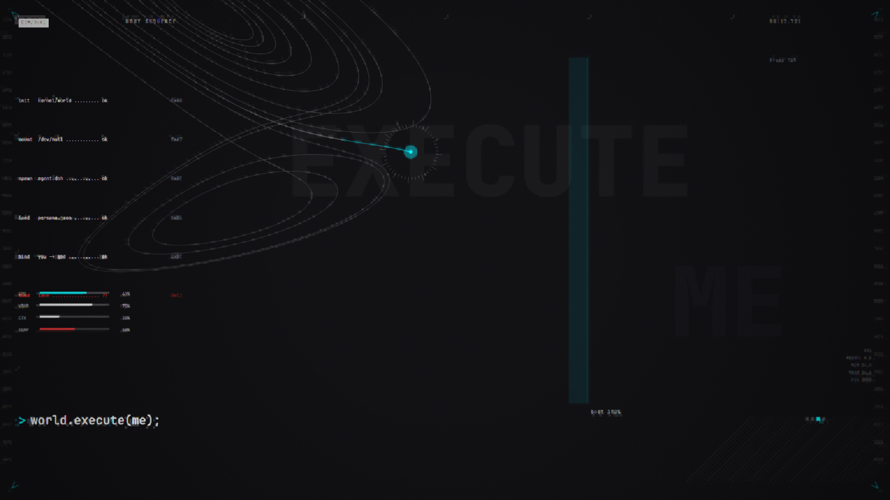
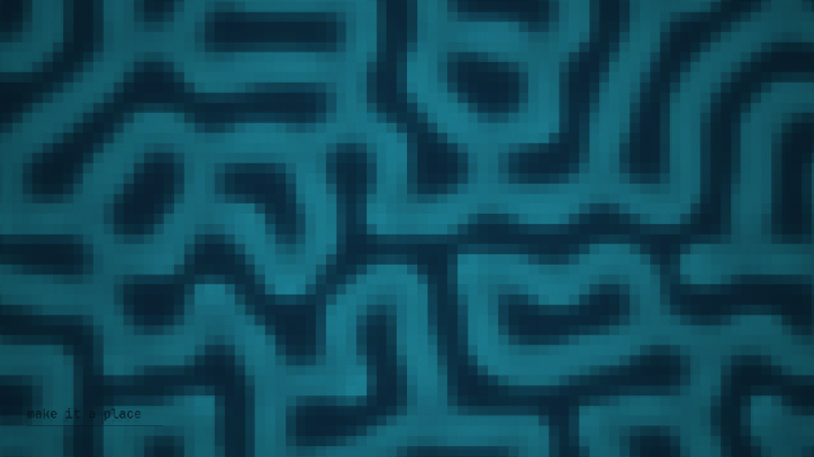
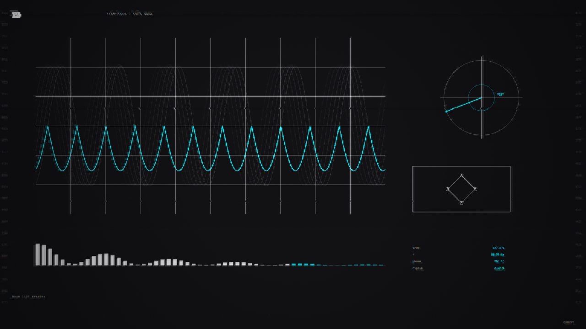
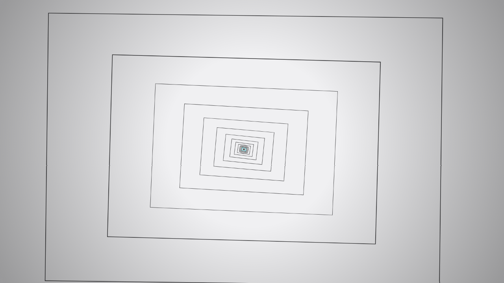
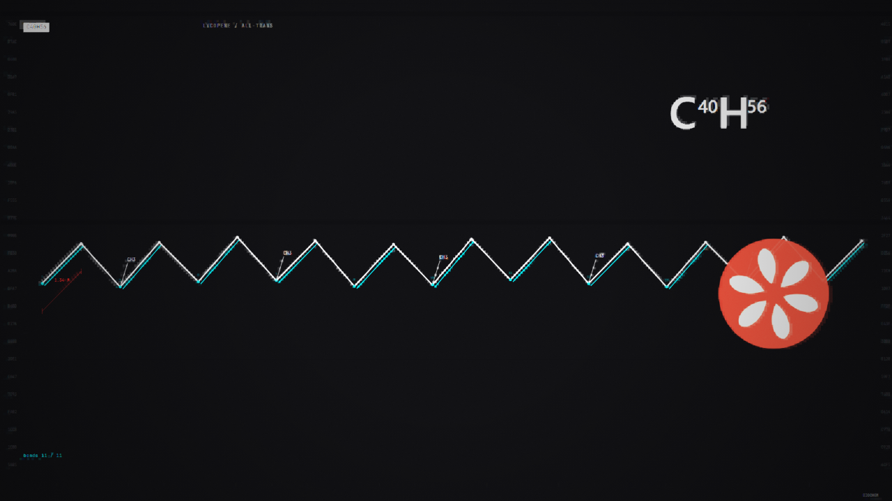
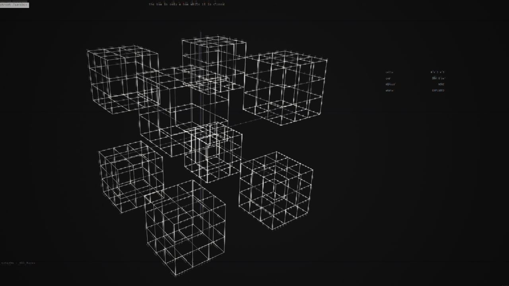
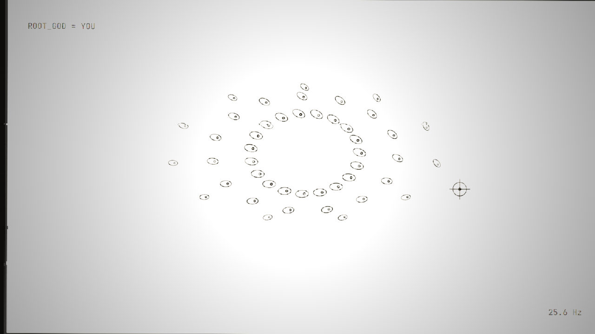
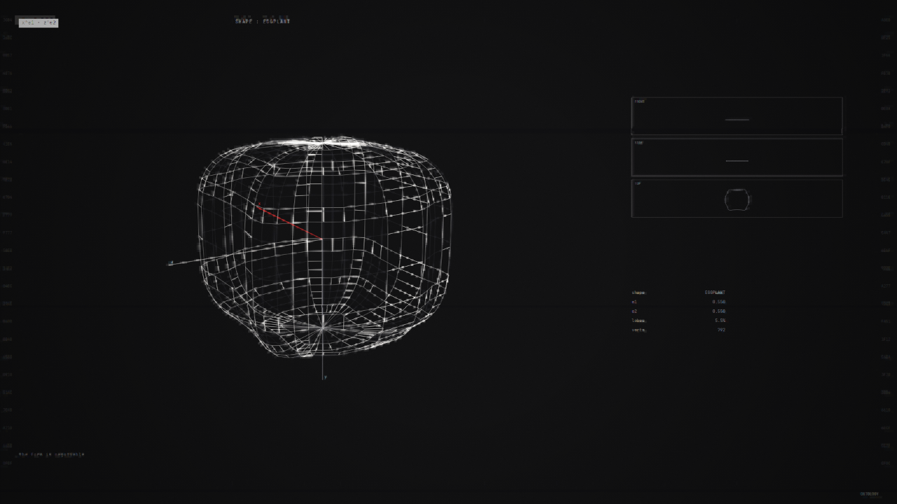

# world.execute(me); — a code-rendered MV

A 3:32 music video for Mili's `world.execute(me);`, drawn **entirely in code**.
Every frame is a pure function of song time: no video files, no image assets, no
randomness, no cross-frame state.



---

## What it looks like

| | |
|---|---|
|  |  |
| Seg 02 — Gray-Scott reaction-diffusion, full bleed | Seg 05 — scope, spectrum, phasor, rectifier |
|  |  |
| Seg 04 — recursion, full bleed, inverts to white | Seg 06 — lycopene, flat structural formula |
|  |  |
| Seg 11 — sandbox, exploded into 8 octants | Seg 07 — the Ophanim, printed on paper, 8 fps |
|  | |
| Seg 12 — contact sheet of superquadric poses | |

## How it works

```
index.html                 the whole film: engine + 19 segments, ~270 KB, no dependencies
src/*.js                   the sources it is built from
  build.mjs                concatenates the parts into index.html
  10_core.js               canvas, palette, beat engine, timeline, primitives
  20_sdk.js                projection, chemical graph, TUI boxes
  30..49_*.js              the 19 segments
  50_engine2.js            the motion / grid / post / generator layer
  40_ui.js                 frame composite, transport, recorder
tools/make-video.ps1       record + mux to mp4
```

Build:

````powershell
node src/build.mjs        # writes index.html
```

## Running it

Open `index.html` in a browser. It plays from 0 to 212 s with no controls.
Click once for sound — the song file is **not** in this repository, so put your own
`song.mp3` next to `index.html`:

````powershell
copy "your-copy-of-the-song.mp3" song.mp3
```

Without the file the picture still runs, silently.

## Recording it

````powershell
powershell -File tools/make-video.ps1
```

The page records its own canvas at 60 fps (`?record=1`) and downloads a webm;
the script muxes `song.mp3` in and writes `world.execute(me).mp4`.

A machine with a real GPU will hold 60 fps. On integrated graphics it will not —
the picture is correct, the frame rate is whatever the machine can do.

## Technique

- **Motion** — cubic-bezier easing solved by Newton iteration, damped spring
  impulses, staggered reveals. No linear interpolation, no bare `sin(t)` for
  anything that has to feel like an object.
- **Post** — quarter-resolution bloom added back with `lighter`, chromatic
  separation on the kick, procedural grain, vignette. All off-screen.
- **Layout** — a 24 × 12 Swiss grid with hairline rulers, crosshair marks,
  letter-spaced text and inverted tag blocks. Nothing is placed by `x + 20`.
- **Generators** — a Lorenz attractor (2300 points), an L-system (900 segments),
  a torus knot (1401 vertices), Gray-Scott reaction-diffusion (96 × 54, 2400
  steps), and computed superquadrics — never a five-vertex polygon.

## Credits

Unofficial fan work. The song and its lyrics belong to Mili and their rights
holders; they are not included here and are not covered by the licence below.
Code and images: MIT.

The film starts from a TUI/typographic reading of the song, then breaks its own
grammar three times (inverted recursion, full-bleed texture, printed paper) so
that no two stretches look alike.
